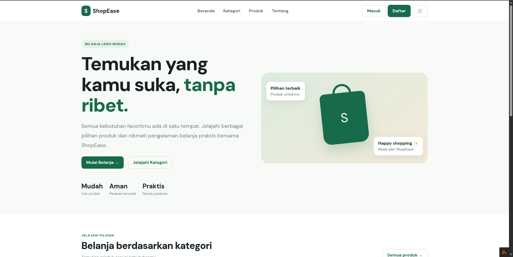

# ShopEase – E-Commerce Application

ShopEase dibuat untuk menyediakan platform belanja online yang memungkinkan pengguna menjelajahi katalog produk, melihat informasi produk, serta mengakses fitur akun dan keranjang belanja. Aplikasi ini juga menyediakan halaman dashboard khusus untuk administrator.

## Gambaran Aplikasi

ShopEase memiliki dua bagian utama:

**1. Customer Side**

Bagian yang digunakan oleh pengunjung dan pelanggan untuk mengakses layanan toko online.

Fitur yang tersedia:
- Homepage yang menampilkan kategori dan produk.
- Katalog untuk melihat daftar produk.
- Halaman detail produk.
- Registrasi akun dan login.
- Halaman keranjang belanja.

**2. Admin Side**

Bagian yang disediakan untuk administrator dalam mengakses dashboard pengelolaan toko.

Fitur yang tersedia:
- Admin dashboard.
- Akses khusus berdasarkan peran pengguna.

## Fitur Aplikasi

| Fitur | Deskripsi |
|---|---|
| Homepage | Menampilkan kategori aktif dan produk terbaru. |
| Product Catalog | Menampilkan daftar produk yang tersedia. |
| Product Details | Menampilkan informasi detail produk berdasarkan slug. |
| User Registration | Memungkinkan pengguna membuat akun. |
| User Login | Memungkinkan pengguna masuk ke aplikasi. |
| Shopping Cart | Menyediakan halaman keranjang belanja. |
| Admin Dashboard | Menyediakan halaman dashboard administrator. |

## Teknologi yang Digunakan

| Komponen | Teknologi |
|---|---|
| Backend Framework | CodeIgniter 4 |
| Programming Language | PHP |
| Database | MySQL / MariaDB |
| Frontend | HTML, CSS, JavaScript |
| Dependency Management | Composer |

## Database

ShopEase menggunakan database `db_shopease` dengan tabel utama berikut:

| Tabel | Fungsi |
|---|---|
| users | Menyimpan data akun pengguna dan peran pengguna. |
| categories | Menyimpan data kategori produk. |
| products | Menyimpan informasi produk, harga, stok, dan kategori. |

## Screenshot



## Struktur Folder

```text
ShopEase/
├── app/
│   ├── Config/
│   ├── Controllers/
│   ├── Models/
│   └── Views/
│       ├── admin/
│       ├── auth/
│       └── frontend/
├── database/
│   └── db_shopease.sql
├── public/
├── writable/
├── docs/
│   └── screenshots/
├── .env
└── README.md
```

## Cara Menjalankan

1. Clone repositori:

   ```bash
   git clone <repository-url>
   cd ShopEase
   ```

2. Install dependency:

   ```bash
   composer install
   ```

3. Salin file konfigurasi environment dan sesuaikan pengaturannya:

   ```bash
   cp env .env
   ```

4. Buat database dan import file SQL:

   ```bash
   mysql -u root -p < database/db_shopease.sql
   ```

5. Sesuaikan konfigurasi database pada `.env`:

   ```ini
   database.default.hostname = localhost
   database.default.database = db_shopease
   database.default.username = your_username
   database.default.password = your_password
   database.default.DBDriver = MySQLi
   database.default.port = 3306
   ```

6. Jalankan aplikasi:

   ```bash
   php spark serve
   ```

7. Buka aplikasi melalui browser:

   ```text
   http://localhost:8080
   ```

## Catatan

- Database menggunakan data contoh untuk keperluan pengembangan dan pengujian.
- Konfigurasi koneksi database perlu disesuaikan dengan lingkungan masing-masing.
- Fitur yang tersedia mengikuti implementasi aplikasi saat ini.