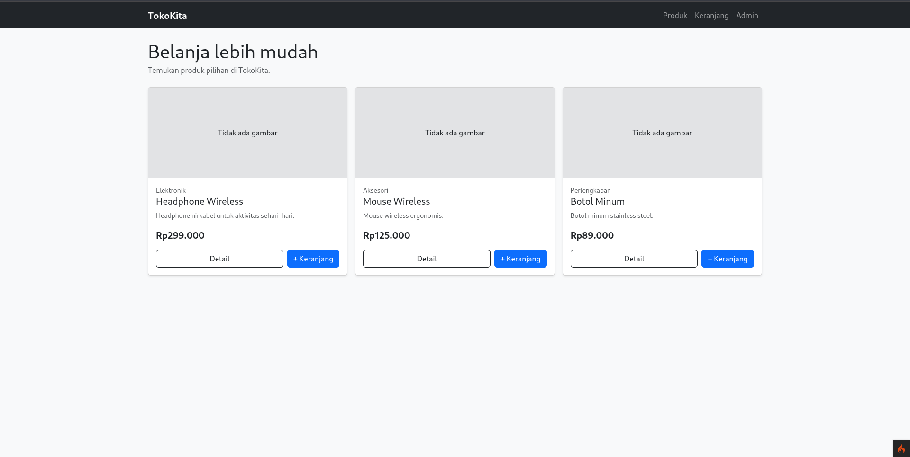
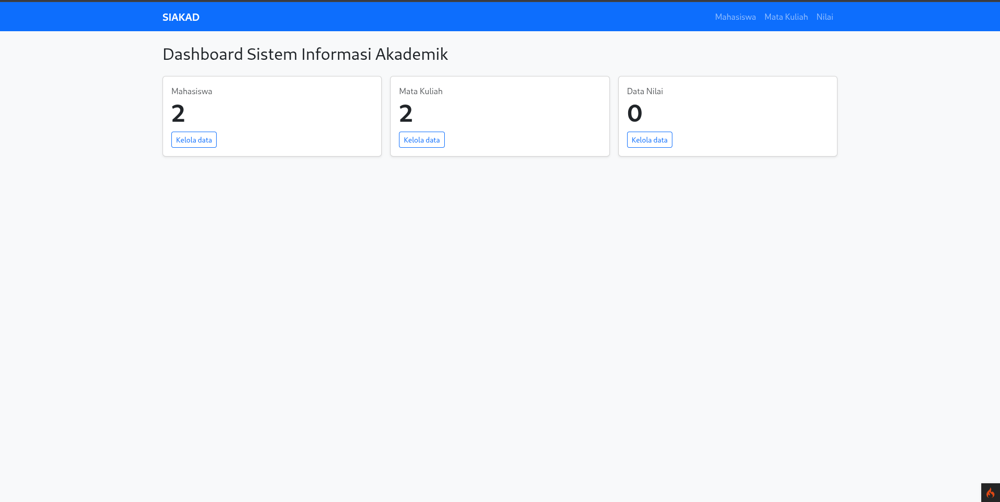

# PBKK - Sistem Informasi Akademik dan Toko Online

## Daftar Aplikasi

| Aplikasi | Deskripsi | Port |
|---|---|---|
| SIAKAD | Sistem Informasi Akademik untuk mengelola data mahasiswa, mata kuliah, dan nilai | `8080` |
| Toko Online | Aplikasi toko online untuk menampilkan produk, mengelola keranjang, checkout, dan administrasi produk | `8081` |

## Teknologi yang Digunakan

- PHP 8.1 atau lebih baru
- CodeIgniter 4
- Composer
- MariaDB / MySQL
- HTML, CSS, dan PHP
- Bootstrap atau komponen tampilan yang tersedia pada source code

## Struktur Direktori

```text
PBKK_CodeIgniter4_SIAKAD_dan_TokoOnline/
│
├── PBKK_CodeIgniter4/
│   ├── SIAKAD_CI4/
│   │   ├── app/
│   │   ├── database/
│   │   │   └── schema.sql
│   │   └── .env.example
│   │
│   └── TokoOnline_CI4/
│       ├── app/
│       ├── database/
│       │   └── schema.sql
│       └── .env.example
│
├── SIAKAD/
│   ├── app/
│   ├── public/
│   ├── writable/
│   ├── database/
│   ├── spark
│   └── .env
│
├── TokoOnline/
│   ├── app/
│   ├── public/
│   ├── writable/
│   ├── database/
│   ├── spark
│   └── .env
│
└── README.md
```

Keterangan:

- `PBKK_CodeIgniter4/` berisi source code aplikasi yang disediakan.
- `SIAKAD/` merupakan project CodeIgniter 4 yang digunakan untuk menjalankan aplikasi SIAKAD.
- `TokoOnline/` merupakan project CodeIgniter 4 yang digunakan untuk menjalankan aplikasi Toko Online.
- `database/schema.sql` berisi struktur tabel dan data awal database.
- `.env` berisi konfigurasi lingkungan dan koneksi database.

---

# 1. Persiapan Lingkungan

Panduan instalasi berikut menggunakan Debian 13 atau distribusi Linux berbasis Debian.

### 1.1. Install PHP dan ekstensi yang dibutuhkan

Jalankan:

```bash
sudo apt update

sudo apt install -y \
    php \
    php-cli \
    php-intl \
    php-mbstring \
    php-mysql \
    php-xml \
    php-curl \
    php-zip \
    unzip \
    composer \
    mariadb-server
```

Periksa instalasi:

```bash
php -v
composer --version
```

### 1.2. Install dan jalankan MariaDB

```bash
sudo systemctl enable --now mariadb
```

Periksa status MariaDB:

```bash
sudo systemctl status mariadb
```

Pastikan status service menunjukkan `active (running)`.

### 1.3. Membuat project CodeIgniter 4

Jika folder `SIAKAD/` dan `TokoOnline/` belum dibuat, jalankan dari direktori utama repository:

```bash
composer create-project codeigniter4/appstarter SIAKAD

composer create-project codeigniter4/appstarter TokoOnline
```

Perintah tersebut membuat dua project CodeIgniter 4 menggunakan template resmi AppStarter.

Jika kedua folder project sudah tersedia dan Composer berhasil menyelesaikan instalasi sebelumnya, langkah ini tidak perlu diulangi.

---

# 2. Menyiapkan Source Code

Pastikan terminal berada di direktori utama repository.

### 2.1. Menyalin source code SIAKAD

```bash
cp -a PBKK_CodeIgniter4/SIAKAD_CI4/app/. SIAKAD/app/

cp -a PBKK_CodeIgniter4/SIAKAD_CI4/database SIAKAD/

cp PBKK_CodeIgniter4/SIAKAD_CI4/.env.example SIAKAD/.env
```

### 2.2. Menyalin source code Toko Online

```bash
cp -a PBKK_CodeIgniter4/TokoOnline_CI4/app/. TokoOnline/app/

cp -a PBKK_CodeIgniter4/TokoOnline_CI4/database TokoOnline/

cp PBKK_CodeIgniter4/TokoOnline_CI4/.env.example TokoOnline/.env
```

Perintah `cp -a` digunakan untuk menyalin isi direktori beserta struktur subdirektorinya.

**Catatan:** Perintah penyalinan `.env.example` akan menimpa `.env` yang sudah ada. Jika sebelumnya sudah mengatur konfigurasi database, pastikan konfigurasi tersebut disimpan terlebih dahulu.

---

# 3. Konfigurasi Database

Kedua aplikasi menggunakan database terpisah agar data masing-masing aplikasi tidak tercampur.

| Aplikasi | Nama Database |
|---|---|
| SIAKAD | `siakad_db` |
| Toko Online | `toko_online_db` |

### 3.1. Membuat database SIAKAD

Dari direktori utama repository:

```bash
sudo mariadb < SIAKAD/database/schema.sql
```

### 3.2. Membuat database Toko Online

```bash
sudo mariadb < TokoOnline/database/schema.sql
```

Kedua file SQL akan membuat database, tabel, relasi, dan data awal yang diperlukan aplikasi.

### 3.3. Membuat user database

Buat user khusus agar aplikasi tidak perlu menggunakan akun root MariaDB.

```bash
sudo mariadb
```

Jalankan SQL berikut:

```sql
CREATE USER IF NOT EXISTS 'pbkk'@'localhost'
IDENTIFIED BY 'pbkk12345';

GRANT ALL PRIVILEGES ON siakad_db.*
TO 'pbkk'@'localhost';

GRANT ALL PRIVILEGES ON toko_online_db.*
TO 'pbkk'@'localhost';

FLUSH PRIVILEGES;

EXIT;
```

### 3.4. Memeriksa database

```bash
mariadb -u pbkk -p -e "SHOW DATABASES;"
```

Masukkan password:

```text
pbkk12345
```

Pastikan database berikut tersedia:

```text
siakad_db
toko_online_db
```

---

# 4. Konfigurasi Environment

Setiap aplikasi mempunyai file `.env` masing-masing.

## 4.1. Konfigurasi SIAKAD

Buka file:

```bash
nano SIAKAD/.env
```

Atur konfigurasi berikut:

```ini
CI_ENVIRONMENT = development

database.default.hostname = localhost
database.default.database = siakad_db
database.default.username = pbkk
database.default.password = pbkk12345
database.default.DBDriver = MySQLi
database.default.port = 3306
```

Simpan file.

## 4.2. Konfigurasi Toko Online

Buka:

```bash
nano TokoOnline/.env
```

Atur konfigurasi:

```ini
CI_ENVIRONMENT = development

database.default.hostname = localhost
database.default.database = toko_online_db
database.default.username = pbkk
database.default.password = pbkk12345
database.default.DBDriver = MySQLi
database.default.port = 3306
```

Simpan file.

**Penting:**

- Jangan menambahkan tanda `#` di depan konfigurasi yang ingin diaktifkan.
- Pastikan nama database sesuai dengan aplikasi.
- Jika password user database diubah, sesuaikan juga kedua file `.env`.
- Jangan mengunggah file `.env` yang berisi password ke repository publik.

---

# 5. Menjalankan Aplikasi

Kedua aplikasi dijalankan menggunakan server development bawaan CodeIgniter 4.

## 5.1. Menjalankan SIAKAD

Buka terminal pertama:

```bash
cd SIAKAD

php spark --version

php spark routes

php spark serve --host 127.0.0.1 --port 8080
```

Akses aplikasi melalui:

**http://localhost:8080**

## 5.2. Menjalankan Toko Online

Buka terminal kedua:

```bash
cd TokoOnline

php spark --version

php spark routes

php spark serve --host 127.0.0.1 --port 8081
```

Akses aplikasi melalui:

**http://localhost:8081**

Biarkan kedua terminal tetap berjalan selama aplikasi digunakan.

Untuk menghentikan server, tekan:

```text
Ctrl + C
```

---

# 6. Fitur Aplikasi

## 6.1. Sistem Informasi Akademik (SIAKAD)

SIAKAD merupakan aplikasi untuk mengelola informasi akademik mahasiswa.

### Fitur yang tersedia

1. **Dashboard**
   - Halaman utama aplikasi.

2. **Manajemen Mahasiswa**
   - Menampilkan daftar mahasiswa.
   - Menambahkan data mahasiswa.
   - Mengedit data mahasiswa.
   - Menghapus data mahasiswa.

3. **Manajemen Mata Kuliah**
   - Menampilkan data mata kuliah.
   - Menambahkan data mata kuliah.

4. **Manajemen Nilai**
   - Menampilkan data nilai mahasiswa.
   - Menambahkan nilai mahasiswa berdasarkan mata kuliah.

### Route SIAKAD

| Method | Route | Fungsi |
|---|---|---|
| GET | `/` | Dashboard |
| GET | `/dashboard` | Dashboard |
| GET | `/mahasiswa` | Menampilkan mahasiswa |
| GET | `/mahasiswa/tambah` | Form tambah mahasiswa |
| POST | `/mahasiswa/simpan` | Menyimpan mahasiswa |
| GET | `/mahasiswa/edit/{id}` | Form edit mahasiswa |
| POST | `/mahasiswa/update/{id}` | Memperbarui mahasiswa |
| GET | `/mahasiswa/hapus/{id}` | Menghapus mahasiswa |
| GET | `/mata-kuliah` | Menampilkan mata kuliah |
| POST | `/mata-kuliah/simpan` | Menyimpan mata kuliah |
| GET | `/nilai` | Menampilkan nilai |
| POST | `/nilai/simpan` | Menyimpan nilai |

### Struktur Database SIAKAD

Database: `siakad_db`

| Tabel | Keterangan |
|---|---|
| `mahasiswa` | Menyimpan data mahasiswa |
| `mata_kuliah` | Menyimpan data mata kuliah |
| `nilai` | Menyimpan nilai mahasiswa |

Relasi utama:

- Satu mahasiswa dapat mempunyai beberapa data nilai.
- Satu mata kuliah dapat mempunyai beberapa data nilai.
- Tabel `nilai` menghubungkan mahasiswa dengan mata kuliah menggunakan foreign key.

## 6.2. Toko Online

Toko Online merupakan aplikasi web untuk menampilkan produk dan melakukan proses pemesanan sederhana.

### Fitur yang tersedia

1. **Beranda**
   - Menampilkan halaman utama toko.

2. **Katalog Produk**
   - Menampilkan daftar produk.
   - Menampilkan detail produk.

3. **Keranjang Belanja**
   - Menambahkan produk ke keranjang.
   - Memperbarui jumlah produk.
   - Menghapus produk dari keranjang.

4. **Checkout**
   - Membuat pesanan berdasarkan isi keranjang.

5. **Administrasi Produk**
   - Menampilkan halaman administrasi produk.
   - Menambahkan produk.
   - Menghapus produk.

### Route Toko Online

| Method | Route | Fungsi |
|---|---|---|
| GET | `/` | Beranda |
| GET | `/produk` | Katalog produk |
| GET | `/produk/{id}` | Detail produk |
| GET | `/keranjang` | Menampilkan keranjang |
| POST | `/keranjang/tambah/{id}` | Menambahkan produk |
| POST | `/keranjang/update` | Memperbarui keranjang |
| GET | `/keranjang/hapus/{id}` | Menghapus produk |
| POST | `/checkout` | Membuat pesanan |
| GET | `/pesanan/selesai/{id}` | Halaman pesanan selesai |
| GET | `/admin` | Administrasi produk |
| POST | `/admin/produk/simpan` | Menambahkan produk |
| POST | `/admin/produk/hapus/{id}` | Menghapus produk |

### Struktur Database Toko Online

Database: `toko_online_db`

| Tabel | Keterangan |
|---|---|
| `kategori` | Menyimpan kategori produk |
| `produk` | Menyimpan informasi produk |
| `pesanan` | Menyimpan data pesanan |
| `detail_pesanan` | Menyimpan rincian produk dalam pesanan |

Relasi utama:

- Satu kategori dapat mempunyai beberapa produk.
- Satu pesanan dapat mempunyai beberapa detail pesanan.
- Detail pesanan menghubungkan pesanan dengan produk.

---

# 7. Memeriksa Route Aplikasi

Untuk melihat seluruh route yang terdaftar di CodeIgniter 4:

SIAKAD:

```bash
cd SIAKAD
php spark routes
```

Toko Online:

```bash
cd TokoOnline
php spark routes
```

Perintah tersebut menampilkan HTTP method, route, dan controller yang menangani setiap permintaan.

---

# 8. Troubleshooting

## 8.1. Error `could not find driver`

Penyebab: ekstensi PHP MySQLi belum terpasang atau belum aktif.

Solusi:

```bash
sudo apt install php-mysql
```

Periksa:

```bash
php -m | grep -i mysqli
```

## 8.2. Error `Access denied for user`

Penyebab:
- Username database salah.
- Password database salah.
- User belum mendapatkan hak akses.

Periksa konfigurasi `.env` dan ulangi pemberian hak akses:

```bash
sudo mariadb
```

```sql
GRANT ALL PRIVILEGES ON siakad_db.*
TO 'pbkk'@'localhost';

GRANT ALL PRIVILEGES ON toko_online_db.*
TO 'pbkk'@'localhost';

FLUSH PRIVILEGES;
EXIT;
```

## 8.3. Error `Unknown database`

Pastikan database sudah dibuat:

```bash
sudo mariadb -e "SHOW DATABASES;"
```

Jika belum tersedia, impor kembali file SQL:

```bash
sudo mariadb < SIAKAD/database/schema.sql

sudo mariadb < TokoOnline/database/schema.sql
```

## 8.4. Error `Address already in use`

Penyebab: port yang ingin digunakan sedang dipakai proses lain.

Gunakan port alternatif:

```bash
php spark serve --port 8082
```

## 8.5. Error pada konfigurasi atau route

Periksa versi CodeIgniter:

```bash
php spark --version
```

Periksa route:

```bash
php spark routes
```

Bersihkan cache:

```bash
php spark cache:clear
```

## 8.6. Memeriksa service MariaDB

```bash
sudo systemctl status mariadb
```

Jika service berhenti:

```bash
sudo systemctl restart mariadb
```

---

# 9. Batasan Implementasi

Aplikasi ini merupakan implementasi pembelajaran dan belum ditujukan untuk penggunaan produksi.

Beberapa fitur yang belum termasuk dalam implementasi:

### SIAKAD
- Autentikasi pengguna.
- Pembagian hak akses administrator, dosen, dan mahasiswa.
- Pengelolaan KRS.
- Pengelolaan jadwal perkuliahan.
- Validasi dan pelaporan akademik yang lebih lengkap.

### Toko Online
- Autentikasi pelanggan dan administrator.
- Pembayaran melalui payment gateway.
- Integrasi pengiriman.
- Upload gambar produk.
- Riwayat transaksi pelanggan.
- Validasi stok dan proses pemesanan yang lebih lengkap.

**Peringatan keamanan:** Route administrasi Toko Online belum dilindungi autentikasi. Jangan mengekspos aplikasi ini ke internet atau menggunakan data transaksi sungguhan sebelum menambahkan sistem keamanan yang sesuai.

---

# 10. Ringkasan Perintah

| Kebutuhan | Perintah |
|---|---|
| Memeriksa versi PHP | `php -v` |
| Memeriksa versi Composer | `composer --version` |
| Memeriksa versi CodeIgniter | `php spark --version` |
| Melihat daftar route | `php spark routes` |
| Menjalankan SIAKAD | `php spark serve --port 8080` |
| Menjalankan Toko Online | `php spark serve --port 8081` |
| Membersihkan cache | `php spark cache:clear` |
| Memeriksa database | `sudo mariadb -e "SHOW DATABASES;"` |
| Memeriksa MariaDB | `sudo systemctl status mariadb` |

## URL Aplikasi

| Aplikasi | URL |
|---|---|
| SIAKAD | http://localhost:8080 |
| Toko Online | http://localhost:8081 |

---



