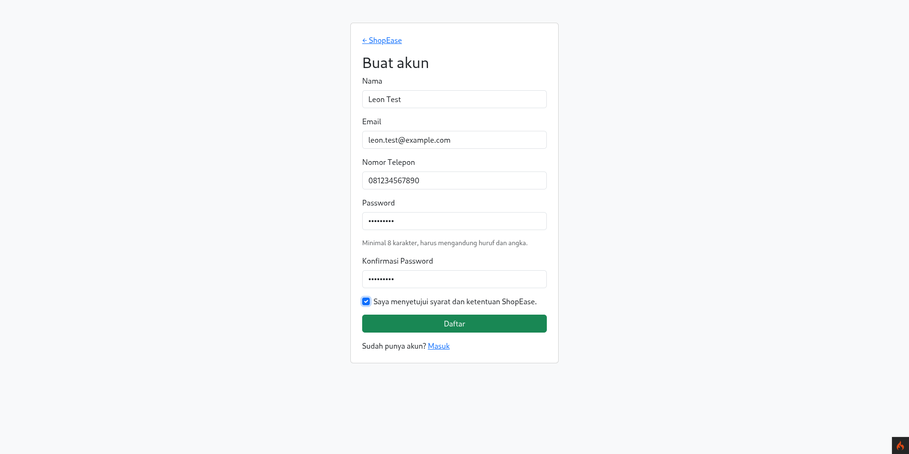
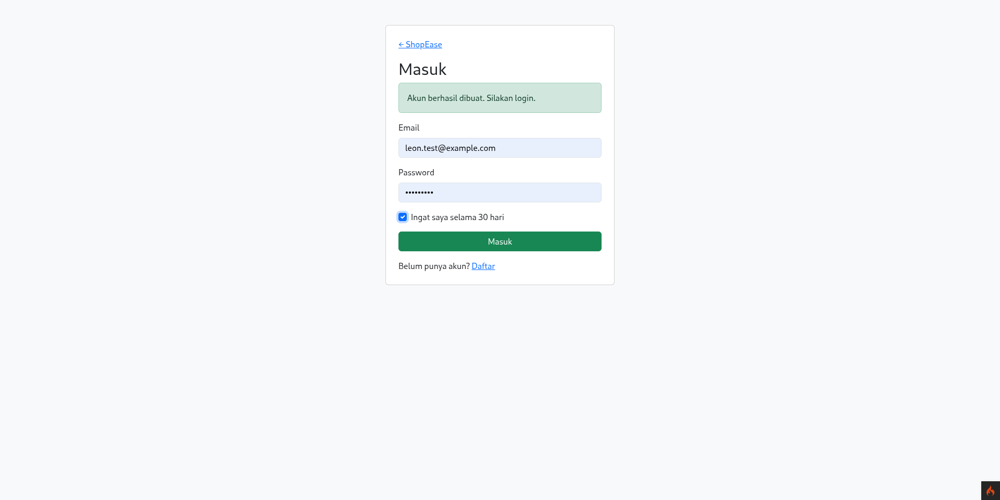
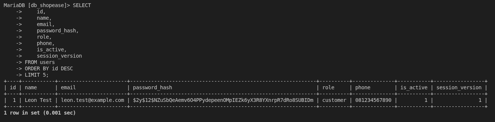
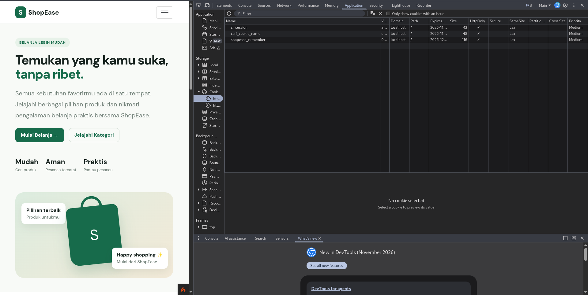
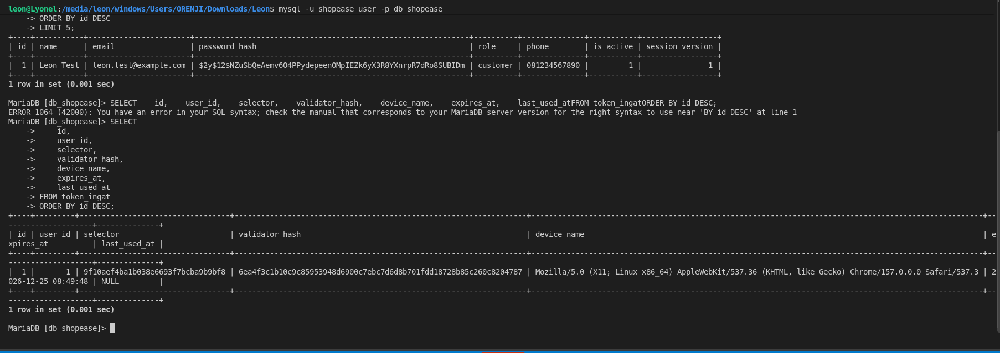

# Sistem Autentikasi ShopEase

ShopEase menyediakan mekanisme registrasi, login, logout, serta fitur *Remember Me* agar pengguna dapat tetap masuk tanpa harus melakukan autentikasi kembali setiap kali membuka aplikasi.

## 1. Tujuan Aplikasi

Pengembangan ShopEase bertujuan untuk:

- Mengimplementasikan sistem autentikasi pengguna menggunakan CodeIgniter 4.
- Menyediakan proses registrasi dan login yang aman.
- Mengimplementasikan penyimpanan password menggunakan algoritma bcrypt.
- Mengelola session pengguna dengan aman.
- Menyediakan fitur *Remember Me* menggunakan token berbasis selector dan validator.
- Menerapkan pembatasan percobaan login untuk mengurangi risiko brute-force.
- Menerapkan pembatasan akses berdasarkan role pengguna.
- Mencatat aktivitas percobaan login untuk kebutuhan audit keamanan.

## 2. Teknologi yang Digunakan

| Teknologi | Kegunaan |
|---|---|
| PHP | Bahasa pemrograman backend |
| CodeIgniter 4 | Framework aplikasi web |
| MySQL | Database relasional |
| Bootstrap 5.3.3 | Framework antarmuka pengguna |
| HTML5 | Struktur halaman web |
| CSS | Styling antarmuka |
| Composer | Dependency management PHP |

## 3. Fitur Aplikasi

### 3.1 Registrasi Pengguna

Pengguna dapat membuat akun baru melalui halaman `/daftar`.

Informasi yang diperlukan:

- Nama lengkap.
- Alamat email.
- Nomor telepon Indonesia.
- Password.
- Konfirmasi password.
- Persetujuan syarat dan ketentuan.

Validasi registrasi meliputi:

- Seluruh field wajib diisi.
- Format email harus valid.
- Email harus unik dan belum terdaftar.
- Password minimal 8 karakter.
- Password maksimal 72 byte untuk kompatibilitas bcrypt.
- Password harus mengandung huruf dan angka.
- Konfirmasi password harus sama dengan password.
- Nomor telepon harus mengikuti format nomor telepon Indonesia.
- Pengguna baru secara otomatis mendapatkan role `customer`.

Password tidak disimpan dalam bentuk plaintext. Password diproses menggunakan bcrypt sebelum disimpan ke database.

### 3.2 Login Pengguna

Pengguna yang sudah memiliki akun dapat masuk melalui halaman `/masuk`.

Proses login meliputi:

1. Pengguna memasukkan email dan password.
2. Sistem memvalidasi input.
3. Sistem mencari akun berdasarkan email.
4. Password diverifikasi menggunakan `password_verify()`.
5. Sistem memeriksa status akun dan pembatasan percobaan login.
6. Jika berhasil, session pengguna dibuat.
7. Session ID diregenerasi untuk mengurangi risiko session fixation.
8. Waktu login terakhir diperbarui.

Pesan kegagalan login dibuat secara umum agar sistem tidak mengungkapkan apakah email tertentu terdaftar atau tidak.

### 3.3 Remember Me

ShopEase menyediakan fitur *Remember Me* yang memungkinkan pengguna tetap login setelah browser ditutup.

Mekanismenya:

1. Pengguna mencentang opsi Remember Me ketika login.
2. Sistem menghasilkan selector dan validator menggunakan generator angka acak kriptografis.
3. Cookie menyimpan informasi token yang diperlukan untuk autentikasi kembali.
4. Database hanya menyimpan hash SHA-256 dari validator, bukan validator asli.
5. Ketika pengguna kembali mengakses aplikasi, sistem memvalidasi token.
6. Jika token valid, session pengguna dipulihkan.
7. Token lama dihapus dan diganti dengan token baru (*token rotation*).

Masa berlaku token adalah **30 hari**.

Cookie dikonfigurasi menggunakan atribut:
- `HttpOnly`
- `SameSite=Lax`
- `Secure` mengikuti status koneksi HTTPS.

### 3.4 Logout

Pengguna dapat keluar dari aplikasi melalui endpoint `/keluar`.

Proses logout:

- Menghapus token Remember Me milik perangkat yang sedang digunakan.
- Menghapus cookie Remember Me.
- Mengakhiri session pengguna.

Logout menggunakan metode HTTP POST dan dilindungi CSRF.

### 3.5 Role-Based Access Control

Sistem mendukung tiga role pengguna:

| Role | Keterangan |
|---|---|
| `customer` | Pengguna atau pelanggan toko |
| `admin` | Administrator aplikasi |
| `operator` | Operator aplikasi |

Pembatasan akses dilakukan menggunakan `AuthFilter`.

Filter tersebut memeriksa status autentikasi pengguna dan role yang dimiliki sebelum mengizinkan akses ke halaman tertentu.

Contohnya, halaman `/admin` hanya dapat diakses oleh pengguna dengan role `admin`.

### 3.6 Login Throttling

Untuk mengurangi risiko brute-force, sistem membatasi percobaan login berdasarkan kombinasi alamat IP dan email.

Konfigurasi saat ini:

- Maksimal 5 percobaan dalam periode 60 detik.
- Percobaan berikutnya dibatasi ketika batas tersebut tercapai.

### 3.7 Login History

Sistem menyediakan mekanisme pencatatan percobaan login ke tabel `log_masuk`.

Informasi yang dicatat meliputi:

- ID pengguna jika tersedia.
- Email yang digunakan.
- Alamat IP.
- User agent browser.
- Status percobaan login.
- Alasan kegagalan atau status percobaan.
- Waktu kejadian.

Data tersebut dapat digunakan untuk kebutuhan audit dan pemeriksaan aktivitas autentikasi.

## 4. Struktur Database

Database yang digunakan bernama `db_shopease`.

### 4.1 Tabel `users`

Menyimpan informasi akun pengguna.

| Kolom | Keterangan |
|---|---|
| `id` | Primary key pengguna |
| `name` | Nama pengguna |
| `email` | Email pengguna, harus unik |
| `password_hash` | Hash password menggunakan bcrypt |
| `role` | Role pengguna |
| `phone` | Nomor telepon |
| `is_active` | Status aktif akun |
| `session_version` | Versi session pengguna |
| `last_login_at` | Waktu login terakhir |
| `created_at` | Waktu pembuatan akun |
| `updated_at` | Waktu perubahan data |

### 4.2 Tabel `token_ingat`

Menyimpan token Remember Me untuk setiap perangkat.

| Kolom | Keterangan |
|---|---|
| `id` | Primary key token |
| `user_id` | ID pemilik token |
| `selector` | Identitas token |
| `validator_hash` | Hash validator |
| `device_name` | Informasi perangkat |
| `user_agent` | Informasi browser |
| `ip_address` | Alamat IP |
| `expires_at` | Waktu kedaluwarsa |
| `created_at` | Waktu pembuatan token |
| `last_used_at` | Waktu terakhir token digunakan |

Validator asli tidak disimpan ke database.

### 4.3 Tabel `log_masuk`

Menyimpan riwayat percobaan autentikasi.

| Kolom | Keterangan |
|---|---|
| `id` | Primary key log |
| `user_id` | ID pengguna jika tersedia |
| `email` | Email yang digunakan |
| `ip_address` | Alamat IP |
| `user_agent` | Informasi browser |
| `status` | Status percobaan login |
| `reason` | Alasan atau keterangan |
| `created_at` | Waktu pencatatan |

## 5. Struktur Direktori

Bagian utama aplikasi yang berkaitan dengan autentikasi:

```text
Sistem Autentikasi ShopEase/
│
├── app/
│   ├── Config/
│   │   ├── Akun.php
│   │   ├── Filters.php
│   │   ├── Routes.php
│   │   ├── Services.php
│   │   └── Session.php
│   │
│   ├── Controllers/
│   │   └── AuthController.php
│   │
│   ├── Database/
│   │   └── Migrations/
│   │       └── 2026-11-25-081654_AddAuthenticationSecurity.php
│   │
│   ├── Filters/
│   │   ├── AuthFilter.php
│   │   ├── GuestFilter.php
│   │   └── IdentitasFilter.php
│   │
│   ├── Libraries/
│   │   └── Autentikasi.php
│   │
│   ├── Models/
│   │   ├── UserModel.php
│   │   ├── TokenIngatModel.php
│   │   └── LogMasukModel.php
│   │
│   └── Views/
│       └── auth/
│           ├── login.php
│           └── register.php
│
├── public/
├── writable/
├── tests/
├── .env
├── composer.json
├── composer.lock
├── spark
└── README.md
```

Keterangan komponen autentikasi:

- **AuthController:** menangani tampilan login dan registrasi, pemrosesan login dan registrasi, serta logout.
- **Autentikasi:** library utama untuk mengelola proses autentikasi, session, Remember Me, throttling, dan pencatatan login.
- **UserModel:** mengelola data pengguna dan hashing password.
- **TokenIngatModel:** mengelola token Remember Me.
- **LogMasukModel:** mengelola riwayat percobaan login.
- **AuthFilter:** membatasi akses halaman berdasarkan status autentikasi dan role.
- **GuestFilter:** membatasi halaman login dan registrasi untuk pengguna yang sudah login.
- **IdentitasFilter:** memeriksa identitas pengguna dan mencoba memulihkan session melalui Remember Me.
- **Akun.php:** menyimpan konfigurasi autentikasi seperti masa berlaku token, batas percobaan login, dan label role.
- **Services.php:** mendaftarkan library autentikasi agar dapat dipanggil melalui `service('autentikasi')`.

## 6. Instalasi dan Konfigurasi

### 6.1 Persyaratan Sistem

Pastikan perangkat telah memiliki:

- PHP 8.1 atau versi yang kompatibel dengan CodeIgniter 4.7.6.
- Composer.
- MySQL atau MariaDB.
- Ekstensi PHP yang dibutuhkan CodeIgniter, termasuk MySQLi, Intl, dan Mbstring.

### 6.2 Clone Repository

```bash
git clone <URL_REPOSITORY>
cd "Sistem Autentikasi ShopEase"
```

Ganti `<URL_REPOSITORY>` dengan URL repository project.

### 6.3 Install Dependencies

```bash
composer install
```

### 6.4 Konfigurasi Environment

Salin file `env` menjadi `.env` apabila belum tersedia.

```bash
cp env .env
```

Buka `.env`, kemudian sesuaikan konfigurasi database:

```ini
CI_ENVIRONMENT = development

app.baseURL = 'http://localhost:8080/'

database.default.hostname = localhost
database.default.database = db_shopease
database.default.username = shopease_user
database.default.password = <PASSWORD_DATABASE>
database.default.DBDriver = MySQLi
database.default.port = 3306
```

Ganti `<PASSWORD_DATABASE>` dengan password database yang digunakan.

Jangan mengunggah file `.env` yang berisi kredensial ke repository publik.

### 6.5 Buat Database

Buat database MySQL:

```sql
CREATE DATABASE db_shopease;
```

Pastikan user database memiliki hak akses terhadap database tersebut.

### 6.6 Jalankan Migration

Migration digunakan untuk membuat atau memperbarui struktur tabel database.

```bash
php spark migrate
```

Untuk memeriksa status migration:

```bash
php spark migrate:status
```

### 6.7 Jalankan Aplikasi

```bash
php spark serve
```

Aplikasi dapat diakses melalui:

```text
http://localhost:8080
```

## 7. Daftar Route

Berikut route utama yang tersedia:

| HTTP Method | URL | Fungsi |
|---|---|---|
| GET | `/` | Halaman utama |
| GET | `/products` | Daftar produk |
| GET | `/products/{id}` | Detail produk |
| GET | `/cart` | Keranjang belanja |
| GET | `/daftar` | Halaman registrasi |
| POST | `/daftar` | Memproses registrasi |
| GET | `/masuk` | Halaman login |
| POST | `/masuk` | Memproses login |
| POST | `/keluar` | Logout |
| GET | `/admin` | Halaman administrator |

Terdapat pula alias `/login`, `/register`, dan `/logout` untuk kompatibilitas route.

## 8. Alur Autentikasi

### 8.1 Alur Registrasi

```text
Pengguna membuka /daftar
          |
          v
Mengisi formulir registrasi
          |
          v
Validasi input
          |
          v
Memeriksa email dan password
          |
          v
Password di-hash menggunakan bcrypt
          |
          v
Data disimpan ke tabel users
          |
          v
Registrasi berhasil
          |
          v
Dialihkan ke halaman /masuk
```

### 8.2 Alur Login

```text
Pengguna membuka /masuk
          |
          v
Mengisi email dan password
          |
          v
Validasi input dan throttling
          |
          v
Mencari akun pengguna
          |
          v
Verifikasi password
          |
     +----+----+
     |         |
   Gagal     Berhasil
     |         |
     v         v
Catat log   Regenerasi session
     |         |
     v         v
Tampilkan   Simpan identitas
error       pengguna
               |
               v
         Remember Me dicentang?
               |
          +----+----+
          |         |
        Tidak      Ya
          |         |
          |         v
          |    Buat token
          |         |
          +----+----+
               |
               v
          Login berhasil
```

## 9. Aspek Keamanan

Beberapa mekanisme keamanan yang diterapkan:

1. **Password Hashing:** password disimpan menggunakan bcrypt, bukan plaintext.
2. **Password Verification:** autentikasi menggunakan `password_verify()`.
3. **Password Rehashing:** sistem memeriksa apakah hash password perlu diperbarui menggunakan `password_needs_rehash()`.
4. **Dummy Hash:** sistem melakukan verifikasi terhadap dummy hash ketika email tidak ditemukan untuk membantu mengurangi perbedaan waktu respons.
5. **Session Regeneration:** session ID diperbarui setelah autentikasi berhasil.
6. **Remember Token Hashing:** database hanya menyimpan hash validator.
7. **Token Rotation:** token Remember Me diperbarui setelah digunakan.
8. **Login Throttling:** percobaan login dibatasi berdasarkan IP dan email.
9. **CSRF Protection:** request yang mengubah data dilindungi token CSRF.
10. **Role-Based Authorization:** akses halaman dibatasi berdasarkan role pengguna.
11. **Generic Login Error:** pesan kesalahan login tidak membocorkan keberadaan akun.
12. **Account Status Check:** akun yang tidak aktif tidak dapat digunakan untuk autentikasi normal.

## 10. Pengujian Aplikasi

Pengujian dapat dilakukan menggunakan skenario berikut:

| No. | Skenario | Hasil yang Diharapkan |
|---|---|---|
| 1 | Registrasi dengan data valid | Akun berhasil dibuat |
| 2 | Registrasi dengan email yang sudah digunakan | Registrasi ditolak |
| 3 | Registrasi dengan format email tidak valid | Validasi gagal |
| 4 | Registrasi dengan password kurang dari 8 karakter | Validasi gagal |
| 5 | Registrasi dengan password tanpa angka | Validasi gagal |
| 6 | Registrasi dengan password tanpa huruf | Validasi gagal |
| 7 | Registrasi dengan konfirmasi password berbeda | Validasi gagal |
| 8 | Registrasi tanpa persetujuan | Validasi gagal |
| 9 | Login dengan kredensial benar | Login berhasil |
| 10 | Login dengan password salah | Login ditolak |
| 11 | Login dengan email yang tidak terdaftar | Login ditolak dengan pesan umum |
| 12 | Login dengan Remember Me | Cookie Remember Me dibuat |
| 13 | Membuka kembali aplikasi setelah browser ditutup | Session dapat dipulihkan |
| 14 | Menggunakan token Remember Me | Token dirotasi |
| 15 | Logout | Session dan token perangkat dihapus |
| 16 | Percobaan login melebihi batas | Login dibatasi sementara |
| 17 | Mengakses halaman admin sebagai customer | Akses ditolak |
| 18 | Mengakses halaman login ketika sudah login | Dialihkan ke halaman utama |






